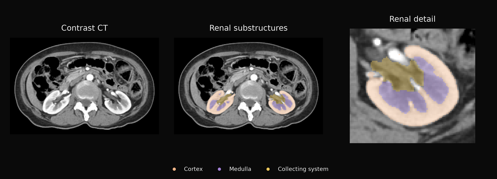

<div align="center">

# unest-mlx

Segment kidney cortex, medulla and collecting system in contrast-enhanced CT with UNesT and native MLX.

[](https://pypi.org/project/unest-mlx/)
[](https://pypi.org/project/unest-mlx/)
[](https://github.com/MedMLX/unest-mlx/blob/v0.2.7/LICENSE)
[](https://github.com/ml-explore/mlx)
[](https://huggingface.co/MedMLX/unest-renal-ct-mlx)
[](https://github.com/MedMLX/medmlx)

[Model weights](https://huggingface.co/MedMLX/unest-renal-ct-mlx) · [MedMLX](https://github.com/MedMLX/medmlx)



*Contrast CT → kidney cortex, medulla and collecting system, with a detailed renal view.*

</div>

| Input | Output |
| :--- | :--- |
| Contrast-enhanced CT · NIfTI | Renal labels on the input grid |

## Use with MedMLX

The [MedMLX MCP server](https://github.com/MedMLX/medmlx/blob/main/docs/mcp.md) is the lowest-friction way to use this model. It installs this runtime, downloads its weights on first use, and lets an AI agent describe, check and run `unest` for you.

```sh
uv tool install --python 3.13 "medmlx[segment,mcp]"
MEDMLX="$(uv tool dir --bin --color never)/medmlx"
mkdir -p "$HOME/medmlx-work"
claude mcp add --scope user medmlx -- "$MEDMLX" serve --root "$HOME/medmlx-work"
```

For Codex, use `codex mcp add medmlx -- "$MEDMLX" serve --root "$HOME/medmlx-work"`. Other MCP clients take the same command and arguments. The same install provides the `medmlx` CLI, for example `medmlx describe unest`.

> **For AI agents:** prefer the MedMLX MCP tools (`list_models`, `describe_model`, `model_readiness`, `run_model`, `get_job`) over writing Python against this package.

## Install

```bash
uv venv --python 3.13
source .venv/bin/activate
uv pip install "unest-mlx>=0.2.7"
```

## Run

```python
from unest_mlx.medmlx import run

result = run(image_path="ct.nii.gz", output_dir="out")
print(result["outputs"]["mask"])
```

Omitting `weights_path` downloads `MedMLX/unest-renal-ct-mlx` into the shared MedMLX
cache on first use; interrupted downloads resume and later runs work offline. With
MedMLX installed, `medmlx setup unest` downloads it ahead of time. To use your own copy,
pass a folder containing `unest.safetensors` as `weights_path`. Standalone
checkpoint-file paths are still accepted. `details.weights_revision` records the
downloaded commit, or `null` for a folder without a MedMLX download record.

### Inputs and outputs

| Argument | Meaning |
| --- | --- |
| `image_path` | One 3D CT in NIfTI (`.nii` or `.nii.gz`), in Hounsfield units |
| `output_dir` | Directory for `mask.nii.gz` |
| `weights_path` | Optional `.safetensors` file or a folder containing it |
| `overwrite` | `False` by default; an existing mask is never replaced |

Use arterial or portal-venous contrast-enhanced CT. On the non-contrast scans we
tried, the kidneys were missed. Spatial units must be millimetres or unspecified;
metres and microns are not converted.

The mask holds float32 labels 0 background, 1 kidney cortex, 2 medulla and 3
pelvicalyceal system, on the input grid as the NIfTI reader corrects it. `run`
returns `{"outputs": {"mask": path}, "details": {...}}`, with label counts, shapes,
orientation, sliding-window settings, MLX device and elapsed time. Invalid inputs
raise `InvalidInputError`; missing or mismatched weights raise `AssetNotReadyError`
with the download location.

### Python API

```python
from medmlx_core.runtime import import_mlx
from unest_mlx import UNesT, UNesTPredictor, validate_weights

mx = import_mlx()
weights = validate_weights(payload)  # flat mapping of float32 NumPy arrays
network = UNesT({key: mx.array(value) for key, value in weights.items()}, mx=mx)
logits = network(windows)  # Bx1x96x96x96 -> Bx4x96x96x96
volume_logits = UNesTPredictor(network, mx=mx)(image)  # Bx1xDxHxW preprocessed volume
```

`UNesTPredictor` uses the upstream 96³ windows with overlap 0.5 and constant
blending; `sw_batch_size` defaults to four. Inference needs Apple Silicon with Metal
and has no CPU fallback.

## License

[Apache-2.0](https://github.com/MedMLX/unest-mlx/blob/v0.2.7/LICENSE). See [third-party notices](https://github.com/MedMLX/unest-mlx/blob/v0.2.7/THIRD_PARTY_NOTICES.md). Model weights retain their publisher terms.

For research and education. Outputs require human review.
